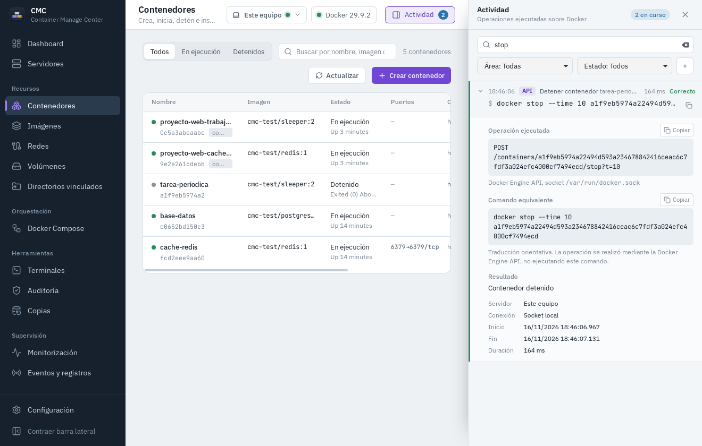

# Container Manage Center (CMC)

**Container Manage Center** es una aplicación de escritorio de software libre
para administrar Docker Engine en el propio equipo y en servidores remotos por
SSH: contenedores, imágenes, redes, volúmenes, directorios vinculados y
proyectos Docker Compose, mostrando en todo momento la operación real que se
ejecuta y su orden `docker` equivalente.

Versión **1.9.1** · Licencia **GPL-3.0-or-later** · Tauri 2, Rust, React,
TypeScript y Vite.


## Objetivo

Docker se administra sobre todo desde la terminal. CMC quiere que trabajar con
Docker sea **visible, comprensible y seguro** sin quitarle nada de control a
quien ya conoce la terminal:

- cada operación se registra con la petición real a la API de Docker (o la
  orden de la CLI), su orden equivalente para copiar, el servidor, la duración
  y el resultado;
- las operaciones destructivas piden confirmación y las configuraciones
  peligrosas (socket de Docker montado, modo privilegiado, `/` del equipo…)
  se avisan antes de crear nada;
- la aplicación nunca instala Docker, no cambia permisos ni grupos del sistema
  y no se ejecuta como administrador.

## Características principales

| Área | Qué se puede hacer |
|---|---|
| Contenedores | Crear con un asistente, iniciar, detener, pausar, reiniciar, eliminar, duplicar, editar la configuración (con recreación segura), crear una imagen, registros, estadísticas, inspección y terminal |
| Imágenes | Descargar con progreso, buscar, construir (BuildKit y clásica), etiquetar, ver capas y uso, eliminar y limpiar |
| Redes, volúmenes y carpetas vinculadas | Crear, conectar, inspeccionar, eliminar y limpiar con avisos de uso |
| Docker Compose | Importar o crear proyectos, editor con validación, desplegar, detener, construir, servicios y registros |
| Terminales | Varias sesiones a la vez, en contenedores y en servidores |
| Servidores remotos | Varios servidores por SSH con la misma funcionalidad, huella del servidor verificada y credenciales en el almacén seguro del sistema |
| Monitorización | CPU, memoria, red, disco y procesos, gráficas de 5 minutos a 24 horas, alertas y notificaciones |
| Copias de seguridad | Volúmenes, bases de datos (MariaDB, MySQL, PostgreSQL, Redis, MongoDB), configuración y Compose, con manifiesto SHA-256, restauración, retención y tareas programadas |
| Auditoría de seguridad | Revisión de contenedores, imágenes y proyectos Compose, correcciones con vista previa y análisis de vulnerabilidades con Trivy o Grype |
| Panel de actividad | Cada operación con su petición real y su orden equivalente; eventos de Docker en tiempo real |
| Interfaz | Ayuda integrada, 8 idiomas (English, Español, Català, Galego, Euskara, Français, Italiano, Português), tema claro u oscuro, color principal morado |

## Capturas de pantalla

| | |
|---|---|
|  |  |
| Contenedores | Asistente de creación |
|  |  |
| Docker Compose | Panel de actividad |

Capturas de la versión de Linux con datos de prueba. Las de Windows están
pendientes de la primera validación en un Windows real.

## Arquitectura tecnológica

```
Interfaz (React + TypeScript, Vite)          ui/
        │  órdenes y eventos de Tauri (IPC)
Aplicación (Rust, Tauri 2)                   src-tauri/
        │
Motor (Rust)            Almacén      Actividad
crates/cmc-engine       cmc-store    cmc-activity
        │
Docker Engine API (bollard) · CLI de Docker Compose · OpenSSH
        │
Socket Unix · tubería de Docker Desktop · `docker system dial-stdio` por SSH
```

Detalles en [ARCHITECTURE.md](ARCHITECTURE.md).

## Plataformas y estado real de compatibilidad

| Plataforma | Estado | Pruebas |
|---|---|---|
| Debian 13 | Admitida | Validación manual del propietario hasta la 1.7.0; la 1.8.0 y posteriores, pendientes de validar a mano ([guía](docs/validation/VALIDACION-1.8.0.md)) |
| Debian 12 | Admitida (paquete compatible) | Paquete compilado para glibc 2.35; sin validación manual |
| Ubuntu 22.04 y 24.04 | Admitida | Regresión automática en Ubuntu 24.04 con Docker 29, 26 y 24; instalación limpia del paquete en Ubuntu 24.04 y 22.04 |
| Windows 10 y 11 (x86_64) | **En pruebas** | Compilación, Clippy y 614 pruebas unitarias con Wine. **Nunca ejecutada en un Windows real** ([auditoría](docs/validation/AUDITORIA-WINDOWS-1.9.1.md)) |

## Requisitos

- **Linux**: Debian 12+ o Ubuntu 22.04+ de 64 bits; Docker Engine 20.10+ (API
  1.41) con acceso al socket; Docker Compose v2 para los proyectos Compose;
  cliente OpenSSH para los servidores remotos.
- **Windows** (en pruebas): Windows 10 o 11 de 64 bits; Docker Desktop con el
  motor de Linux para Docker local; cliente OpenSSH de Windows para los
  servidores remotos.

## Instalación en Debian

```bash
bash scripts/install.sh          # elige el paquete para tu sistema y lo instala con apt
bash scripts/install.sh --check  # solo comprueba el sistema
```

O directamente con el paquete:
`sudo apt install ./container-manage-center_1.9.1_amd64.deb` (en Debian 12, el
paquete `…-compat-debian12-ubuntu2204.deb`). Después se abre desde el menú de
aplicaciones o con `container-manage-center`.

## Instalación en Ubuntu

Igual que en Debian: `bash scripts/install.sh` elige el paquete normal en
Ubuntu 24.04 y el compatible en Ubuntu 22.04.

## Instalación en Windows

**En pruebas** hasta la primera validación en un Windows real
([guía](docs/validation/VALIDACION-WINDOWS.md)). El instalador
(`…_x64-setup.exe`) instala para el usuario actual sin permisos de
administrador, y la aplicación no arranca como administrador (igual que en
Linux no arranca como root). No está firmado: SmartScreen avisará. Requisitos y
diferencias con Linux en
[INSTALL.md](INSTALL.md#opción-d-windows-10-y-11-x86_64--en-pruebas).

## Configuración de Docker

CMC encuentra Docker igual que la CLI de Docker: `DOCKER_HOST`, el contexto
activo, el socket rootless y el socket del sistema (en Windows, las tuberías de
Docker Desktop). Si no puede conectar, explica por qué y qué hacer, sin
ejecutar nada por ti. En Linux, tu usuario necesita acceso al socket (grupo
`docker` o Docker rootless); la aplicación avisa de que el grupo `docker`
equivale a administrador. Detalles en [INSTALL.md](INSTALL.md#acceso-a-docker).

## Compilación desde el código fuente

```bash
bash scripts/install-build-deps.sh   # dependencias de compilación (Debian/Ubuntu)
npm ci
npx tauri build --bundles deb        # paquete .deb en target/release/bundle/deb/
bash scripts/run.sh                  # o ejecutar sin instalar
bash scripts/build-windows.sh        # instalador de Windows de prueba (MinGW-w64)
```

Requisitos de compilación (Rust estable, Node.js 20+, WebKitGTK 4.1) en
[INSTALL.md](INSTALL.md).

## Estructura del repositorio

```
.github/            Flujos de GitHub Actions, plantillas de issues y PR
crates/
  cmc-engine/       Motor: Docker, Compose, SSH, copias, auditoría, monitorización
  cmc-store/        Configuración, servidores y diarios en disco
  cmc-activity/     Registro de actividad y ocultación de secretos
src-tauri/          Aplicación Tauri: órdenes de la interfaz, estado, servicios del sistema
ui/                 Interfaz React + TypeScript (Vite)
scripts/            Instalación, compilación, verificación y avisos de licencias
packaging/          Logotipo, recursos del paquete y del instalador de Windows
docs/               Legal, seguridad, validación, hoja de ruta e imágenes
```

## Documentación

| Documento | Contenido |
|---|---|
| [INSTALL.md](INSTALL.md) | Instalación, requisitos, dependencias, compilación y diagnóstico |
| [USER_GUIDE.md](USER_GUIDE.md) | Uso de la aplicación |
| [ARCHITECTURE.md](ARCHITECTURE.md) | Arquitectura técnica y pruebas |
| [DECISIONS.md](DECISIONS.md) | Decisiones técnicas |
| [STATUS.md](STATUS.md) | Estado del proyecto y resultados de las pruebas |
| [CHANGELOG.md](CHANGELOG.md) | Cambios de cada versión |
| [docs/validation/](docs/validation/) | Auditoría de Windows y guías de validación manual |
| [docs/security/](docs/security/) | Auditoría de seguridad, plan de corrección y lista de comprobación |
| [docs/legal/](docs/legal/) | Licencia, copyright, avisos de terceros y cumplimiento |
| [docs/MIGRATION-CMC.md](docs/MIGRATION-CMC.md) | Actualizar desde versiones anteriores a la 1.8.0 |

## Seguridad

Las credenciales se guardan en el almacén seguro del sistema (Secret Service
en Linux, Administrador de credenciales en Windows), nunca en texto plano, y se
ocultan en el registro de actividad. La huella de los servidores SSH se
verifica siempre. CMC no está certificado ni auditado por terceros. Para
avisar de una vulnerabilidad, usa el aviso privado de GitHub: ver
[SECURITY.md](SECURITY.md).

## Contribuciones

Las contribuciones son bienvenidas: lee [CONTRIBUTING.md](CONTRIBUTING.md)
(licencia, encabezados SPDX, dependencias y pruebas) y el
[código de conducta](CODE_OF_CONDUCT.md).

```bash
git clone https://github.com/SergiioAlfaro/container-manage-center.git
cd container-manage-center
npm ci && npm test                  # interfaz
cargo test --workspace              # Rust
bash scripts/verify-evolution-1.9.1.sh --deb   # regresión completa con Docker
```

## Licencia

Container Manage Center se distribuye con la licencia **GNU General Public
License v3.0 o posterior** ([LICENSE](LICENSE)): puedes redistribuirlo y
modificarlo según sus términos. Se distribuye **sin ninguna garantía**.
Para la versión de Windows, el titular concede un permiso adicional (sección 7
de la GPL v3) para el cargador de WebView2 de Microsoft:
[docs/legal/WEBVIEW2_EXCEPTION.md](docs/legal/WEBVIEW2_EXCEPTION.md).
Los componentes de terceros conservan sus licencias y avisos:
[THIRD_PARTY_NOTICES.md](docs/legal/THIRD_PARTY_NOTICES.md) (Linux) y
[THIRD_PARTY_NOTICES-windows.md](docs/legal/THIRD_PARTY_NOTICES-windows.md)
(Windows).

## Copyright

Copyright © 2026 Sergio Alfaro Lorite. Detalles de la titularidad en
[docs/legal/COPYRIGHT.md](docs/legal/COPYRIGHT.md).

Container Manage Center es un proyecto independiente: no está afiliado a
Docker, Inc. ni respaldado por ella. «Docker» es una marca de Docker, Inc. y
aquí solo se usa para nombrar la tecnología con la que trabaja la aplicación.
