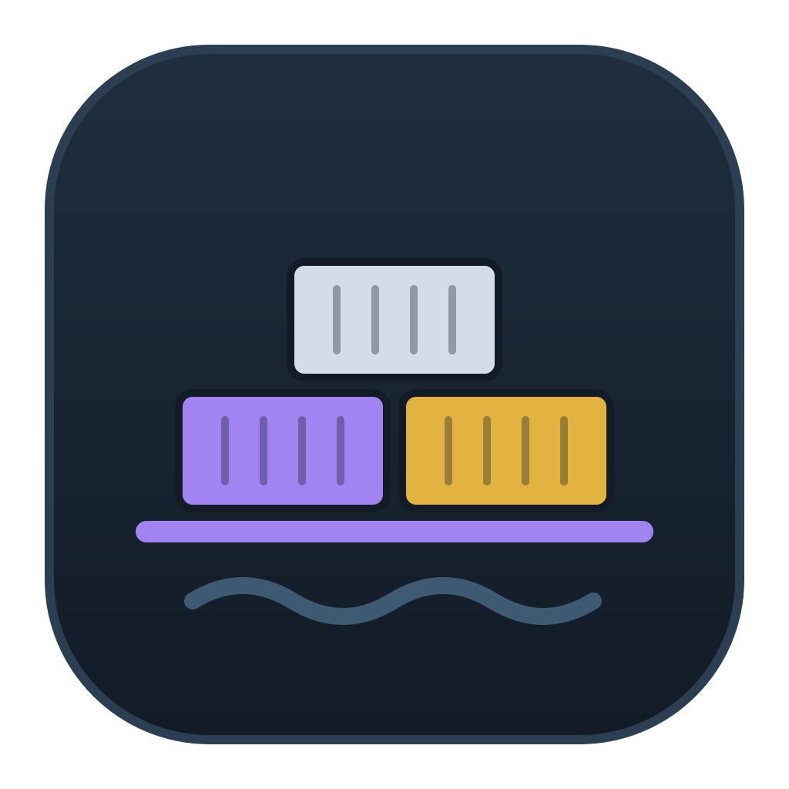
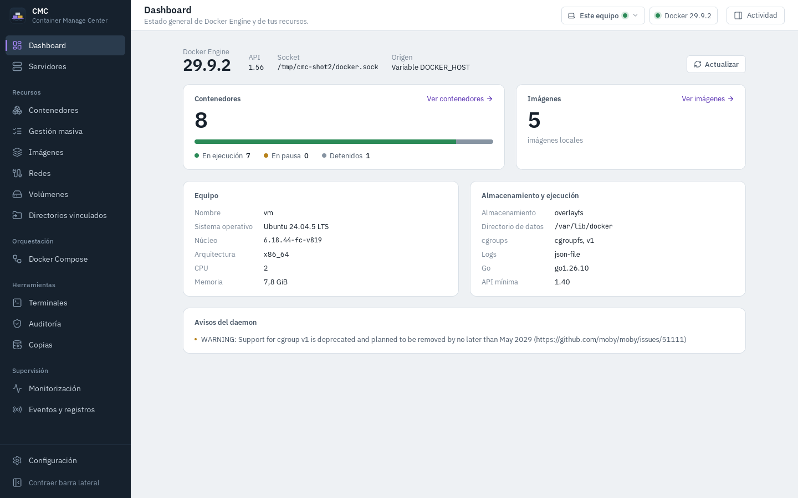
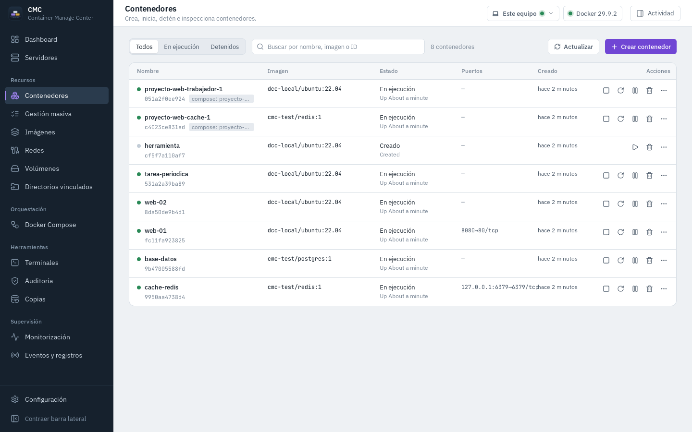
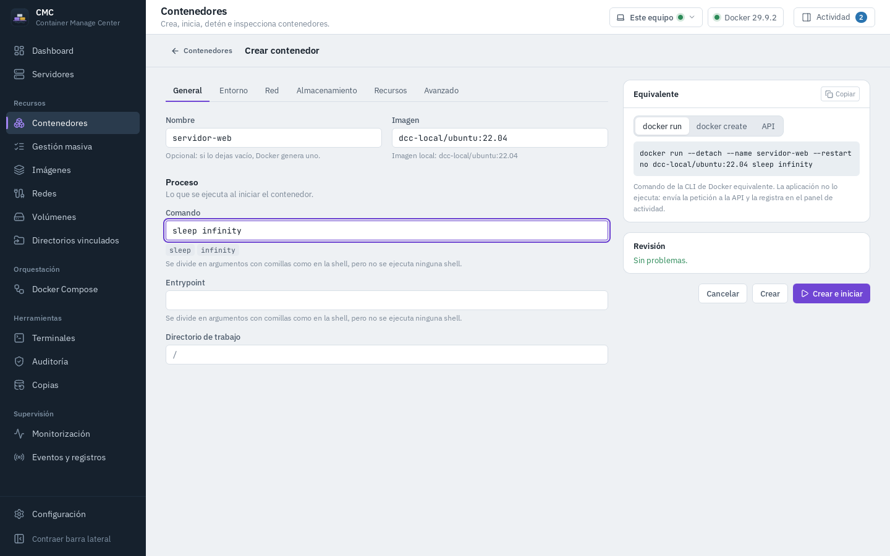
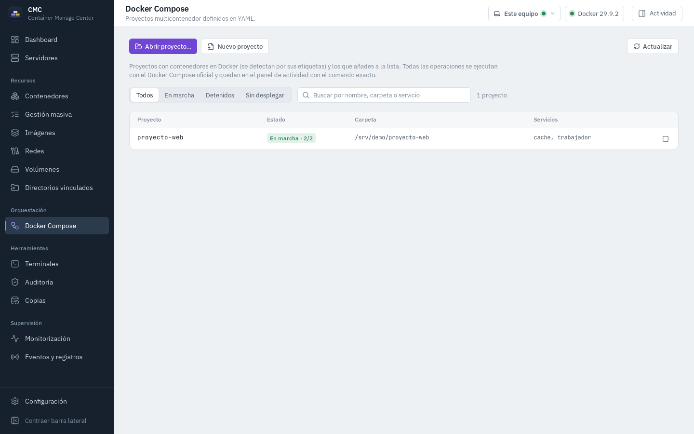
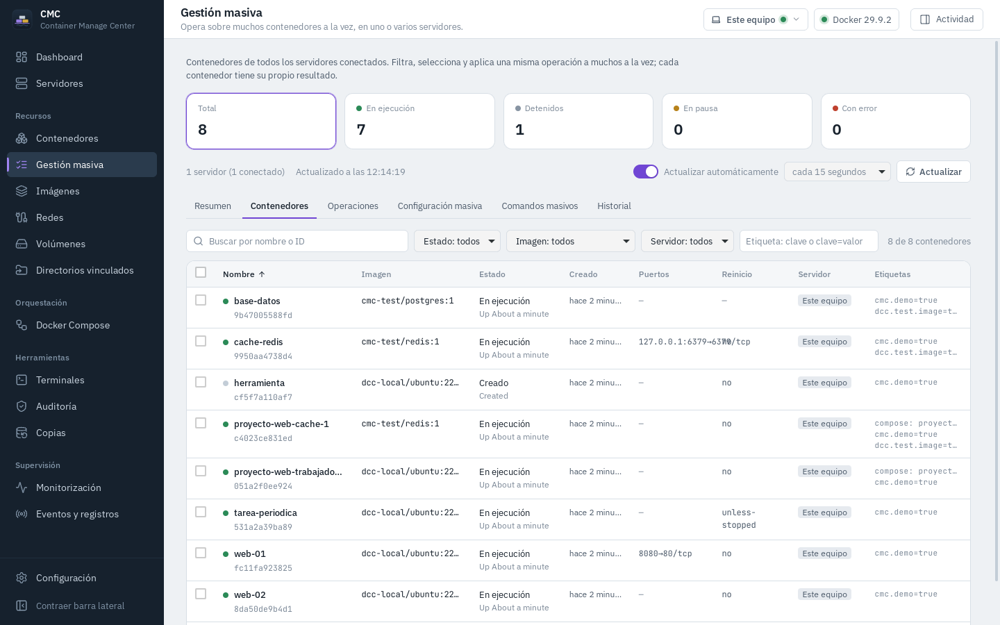

<p align="center">
  
</p>

<h1 align="center">Container Manage Center</h1>

<p align="center">
  <strong>Administra Docker en tu equipo y en tus servidores, viendo siempre qué se ejecuta de verdad.</strong>
</p>

<p align="center">
  Versión 1.11.1 · GPL-3.0-or-later · Linux (Debian, Ubuntu) · Windows 10/11 (en pruebas)
</p>

<p align="center">
  <a href="#instalación">Instalación</a> ·
  <a href="#características">Características</a> ·
  <a href="#especificaciones-técnicas">Especificaciones</a> ·
  <a href="#documentación">Documentación</a> ·
  <a href="docs/Container-Manage-Center-Manual-ES.pdf">Manual (PDF)</a> ·
  <a href="https://github.com/SergiioAlfaro/container-manage-center/releases">Versiones</a> ·
  <a href="#licencia">Licencia</a>
</p>



**Container Manage Center (CMC)** es una aplicación de escritorio de software
libre para administrar Docker Engine en el propio equipo y en servidores
remotos por SSH: contenedores, imágenes, redes, volúmenes, directorios
vinculados y proyectos Docker Compose. Cada operación muestra la petición
real que se envía a Docker y su orden `docker` equivalente, para aprender,
copiar o comprobar lo que hace la aplicación.

## Índice

1. [Objetivo](#objetivo)
2. [Características](#características)
3. [Capturas de pantalla](#capturas-de-pantalla)
4. [Estado por plataforma](#estado-por-plataforma)
5. [Especificaciones técnicas](#especificaciones-técnicas)
6. [Instalación](#instalación)
7. [Configuración de Docker](#configuración-de-docker)
8. [Compilación desde el código fuente](#compilación-desde-el-código-fuente)
9. [Arquitectura](#arquitectura)
10. [Estructura del repositorio](#estructura-del-repositorio)
11. [Documentación](#documentación)
12. [Seguridad](#seguridad)
13. [Contribuciones](#contribuciones)
14. [Licencia](#licencia)
15. [Copyright y marcas](#copyright-y-marcas)

## Objetivo

Docker se administra sobre todo desde la terminal. CMC quiere que trabajar con
Docker sea **visible, comprensible y seguro**, sin quitarle control a quien ya
conoce la terminal:

- **Transparente**: cada operación queda registrada con la petición real a la
  API de Docker (o la orden de la CLI), su orden equivalente, el servidor, la
  duración y el resultado.
- **Prudente**: las operaciones destructivas piden confirmación, y las
  configuraciones peligrosas (socket de Docker montado, modo privilegiado, `/`
  del equipo, `/etc`…) se avisan y hay que aceptarlas antes de crear nada.
- **Respetuosa con el sistema**: nunca instala Docker, no cambia permisos ni
  grupos, no se ejecuta como root ni como administrador y no envía telemetría.

## Características

| Área | Qué se puede hacer |
|---|---|
| **Contenedores** | Crear con un asistente (con la orden `docker run` equivalente y los riesgos para el equipo), iniciar, detener, pausar, reiniciar, eliminar, duplicar, editar la configuración con recreación segura, crear una imagen, registros en directo, estadísticas, inspección JSON y terminal |
| **Gestión masiva** | Una tabla con los contenedores de todos los servidores conectados: indicadores, filtros, orden y selección; iniciar, detener, reiniciar, pausar, reanudar, eliminar (nunca volúmenes ni imágenes) y cambiar la política de reinicio de muchos a la vez, con confirmación, progreso y resultado por contenedor. **Comandos masivos**: el mismo comando dentro de varios contenedores con Docker Exec (sin shell del equipo), con riesgo, tiempo máximo, salida y código de salida de cada uno, exportación y comandos frecuentes |
| **Imágenes** | Descargar con progreso por capa, buscar, construir (BuildKit y clásica), etiquetar, ver capas y uso, eliminar y limpiar |
| **Redes, volúmenes y carpetas** | Crear, conectar, inspeccionar, eliminar y limpiar, con avisos de quién los usa |
| **Docker Compose** | Abrir o crear proyectos, editor con validación, desplegar, detener, construir, servicios, salida y registros |
| **Terminales** | Hasta 12 sesiones a la vez, en contenedores locales o remotos y en servidores |
| **Servidores remotos** | Varios servidores por SSH con la misma funcionalidad que en local; huella del servidor verificada; diagnóstico paso a paso |
| **Monitorización** | CPU, memoria, red, disco y procesos; gráficas de 5 minutos a 24 horas; alertas y notificaciones |
| **Copias de seguridad** | Volúmenes, bases de datos (MariaDB, MySQL, PostgreSQL, Redis, MongoDB), configuración y Compose; manifiesto SHA-256, restauración, retención y tareas programadas |
| **Auditoría de seguridad** | Revisión de contenedores, imágenes y proyectos Compose; correcciones con vista previa; vulnerabilidades con Trivy o Grype |
| **Panel de actividad** | Cada operación con su petición real y su orden equivalente; eventos de Docker en tiempo real |
| **Interfaz** | Manual integrado de 34 secciones (el mismo que el PDF), 8 idiomas, tema claro u oscuro, atajos de teclado |

## Capturas de pantalla

| | |
|---|---|
|  |  |
| **Contenedores**: filtros y acciones según el estado | **Creación**: orden equivalente y riesgos para el equipo |
|  |  |
| **Docker Compose**: servicios, despliegue y registros | **Actividad**: la petición real y la orden `docker` |
|  | |
| **Gestión masiva**: muchos contenedores y servidores a la vez | |

Capturas reales de la versión 1.11.1 de Linux (Ubuntu 24.04, Docker 29.9.2)
con datos de demostración. El [manual en PDF](docs/Container-Manage-Center-Manual-ES.pdf)
tiene una captura de cada apartado. Las de Windows están pendientes de la
primera validación en un Windows real.

## Estado por plataforma

| Plataforma | Estado | Cómo se ha comprobado |
|---|---|---|
| Ubuntu 24.04 | **Admitida** | Regresión automática con Docker 29, 26 y 24; instalación limpia del paquete |
| Ubuntu 22.04 | **Admitida** (paquete compatible) | Instalación limpia del paquete compatible |
| Debian 13 | **Admitida** | Validación manual del propietario hasta la 1.7.0; desde la 1.8.0, pendiente ([guía](docs/validation/VALIDACION-1.8.0.md)) |
| Debian 12 | **Admitida** (paquete compatible) | Paquete para glibc ≥ 2.34; sin validación manual |
| Windows 10 y 11 (x86_64) | **En pruebas** | 1.11.1: el instalador se compila con MSVC en GitHub Actions (runner de Windows) y las pruebas unitarias se ejecutan allí (ver [STATUS.md](STATUS.md)). **La aplicación nunca se ha ejecutado en un Windows real** ([auditoría](docs/validation/AUDITORIA-WINDOWS-1.9.1.md)) |

## Especificaciones técnicas

### Requisitos del sistema

| | Linux | Windows (en pruebas) |
|---|---|---|
| Sistema | Debian 12+, Ubuntu 22.04+ (64 bits, x86_64) | Windows 10 22H2 (19045) o posterior, Windows 11 (x64) |
| Docker local | Docker Engine 20.10 o posterior, con acceso al socket (grupo `docker` o rootless) | Docker Desktop con el motor de Linux (WSL 2 o Hyper-V) |
| Docker Compose | Plugin v2 (`docker compose`) | Incluido en Docker Desktop |
| Servidores remotos | Cliente OpenSSH | Cliente OpenSSH de Windows |
| Motor web | WebKitGTK 4.1 (dependencia del paquete) | WebView2 Runtime (incluido en Windows 11; el instalador lo descarga si falta) |
| Pantalla | Ventana de 1320 × 840; mínimo 960 × 600 | Igual |

### Compatibilidad con Docker

| Aspecto | Especificación |
|---|---|
| API de Docker Engine | Mínimo **1.41** (Docker 20.10); si el motor es más antiguo, se explica y no se conecta |
| Versiones probadas | Docker **29.9.2** (API 1.56), **26.1.3** (API 1.45) y **24.0.7** (API 1.43); Compose **2.26.1** |
| Conexión local | `DOCKER_HOST`, contexto activo de Docker, socket rootless y `/var/run/docker.sock`; en Windows, `npipe:////./pipe/docker_engine` y las tuberías de Docker Desktop |
| Conexión remota | SSH con `docker system dial-stdio`; contraseña, clave o agente; saltos (`ProxyJump`) |
| Rootless | Admitido (detecta el socket del usuario); sin probar en un equipo real |

### Pila tecnológica

| Capa | Tecnología |
|---|---|
| Aplicación de escritorio | Tauri **2.12** |
| Núcleo | Rust (edición 2021, versión mínima 1.80), Tokio 1.54 |
| API de Docker | bollard 0.21 |
| Interfaz | React 19, TypeScript 5.8, Vite 7 |
| Terminal | xterm.js 5.5 |
| Traducciones | i18next 25: English, Español, Català, Galego, Euskara, Français, Italiano, Português |
| Pruebas | `cargo test`, Vitest 5 (444 pruebas de interfaz), pruebas con Docker real y laboratorio SSH |

### Datos y almacenamiento

| Qué | Linux | Windows |
|---|---|---|
| Configuración y servidores | `~/.config/container-manage-center/` (archivos 0600) | `%APPDATA%\container-manage-center` |
| Historial, registros y estado | `~/.local/state/container-manage-center/` | `%LOCALAPPDATA%\container-manage-center` |
| Contraseñas y frases de clave | Secret Service (llavero del escritorio) | Administrador de credenciales |
| Huellas de servidores SSH | `known_hosts` propio de la aplicación (no toca `~/.ssh`) | Igual |

Desinstalar no borra los datos del usuario.

### Paquetes de la versión 1.11.1

Se publican en [Releases](https://github.com/SergiioAlfaro/container-manage-center/releases) con `SHA256SUMS`.

| Paquete | Para | Tamaño |
|---|---|---|
| `container-manage-center_1.11.1_amd64.deb` | Ubuntu 24.04, Debian 13 (glibc ≥ 2.39) | 7,9 MiB |
| `container-manage-center_1.11.1_amd64-compat-debian12-ubuntu2204.deb` | Debian 12, Ubuntu 22.04 (glibc ≥ 2.34) | ver la Release |
| `Container Manage Center_1.11.1_x64-setup-msvc.exe` | Windows 10/11, instalación para el usuario sin administrador; sin firmar; compilado en GitHub Actions. **En pruebas: no se ha ejecutado en un Windows real** | ver la Release |
| `container-manage-center-1.11.1-src.tar.gz` | Código fuente correspondiente | — |
| `Container-Manage-Center-Manual-1.11.1-ES.pdf` | Manual de usuario y técnico | 2,9 MiB |

### Seguridad

| Medida | Detalle |
|---|---|
| Sin shell | Las órdenes se ejecutan con argumentos separados, nunca a través de una shell |
| Confirmaciones | Toda operación destructiva se confirma en el backend, no solo en la interfaz |
| Riesgos para el equipo | Socket de Docker, modo privilegiado, capacidades, carpetas del sistema y de credenciales: se avisan y se aceptan uno a uno |
| Secretos | En el llavero del sistema; ocultos en registros, actividad y exportaciones; borrados de la memoria al dejar de usarlos |
| SSH | Huella verificada siempre; se avisa si cambia |
| Privilegios | No arranca como root (Linux) ni como administrador (Windows) |
| Red | Sin telemetría; solo se conecta a Docker, a los servidores configurados y, si se activa, a la fuente de actualizaciones |
| Dependencias | `cargo deny` (avisos, licencias y orígenes) y `npm audit` en cada verificación |

## Instalación

### Debian y Ubuntu

```bash
bash scripts/install.sh          # elige el paquete adecuado para tu sistema y lo instala con apt
bash scripts/install.sh --check  # solo comprueba el sistema
```

O directamente con el paquete: `sudo apt install ./container-manage-center_1.11.1_amd64.deb`
(en Debian 12 o Ubuntu 22.04, el paquete `…-compat-debian12-ubuntu2204.deb`).
Después se abre desde el menú de aplicaciones o con `container-manage-center`.

### Windows (en pruebas)

Ejecuta `Container Manage Center_1.11.1_x64-setup-msvc.exe` (de [Releases](https://github.com/SergiioAlfaro/container-manage-center/releases)): instala para el usuario
actual sin permisos de administrador. Como no está firmado, SmartScreen
avisará («Más información › Ejecutar de todas formas»). La aplicación no
arranca como administrador. Requisitos y diferencias con Linux en
[INSTALL.md](INSTALL.md#opción-d-windows-10-y-11-x86_64--en-pruebas); guía de
la primera prueba en [VALIDACION-WINDOWS.md](docs/validation/VALIDACION-WINDOWS.md).

## Configuración de Docker

CMC encuentra Docker igual que la CLI de Docker. Si no puede conectar, el
Dashboard explica la causa y los pasos para resolverla, con las órdenes para
copiar, sin ejecutar nada por ti. En Linux, tu usuario necesita acceso al
socket (grupo `docker` o Docker rootless); la aplicación avisa de que el grupo
`docker` equivale a administrador. Detalles en
[INSTALL.md](INSTALL.md#acceso-a-docker).

## Compilación desde el código fuente

```bash
git clone https://github.com/SergiioAlfaro/container-manage-center.git
cd container-manage-center
bash scripts/install-build-deps.sh   # dependencias de compilación (Debian/Ubuntu)
npm ci
bash scripts/run.sh                  # ejecutar sin instalar
npx tauri build --bundles deb        # paquete .deb en target/release/bundle/deb/
bash scripts/build-windows.sh        # instalador de Windows (MinGW-w64)
```

Requisitos de compilación: Rust estable (mínimo 1.80), Node.js 20 o
posterior y WebKitGTK 4.1. Detalles en [INSTALL.md](INSTALL.md).

## Arquitectura

```
Interfaz (React + TypeScript, Vite)          ui/
        │  órdenes y eventos de Tauri (IPC)
Aplicación (Rust, Tauri 2)                   src-tauri/
        │
Motor (Rust)            Almacén      Actividad
crates/cmc-engine       cmc-store    cmc-activity
        │
Docker Engine API (bollard) · CLI de Docker Compose · OpenSSH
        │
Socket Unix · tubería de Docker Desktop · `docker system dial-stdio` por SSH
```

Detalles en [ARCHITECTURE.md](ARCHITECTURE.md) y en el manual técnico.

## Estructura del repositorio

```
.github/            Flujos de GitHub Actions, plantillas de issues y PR
crates/
  cmc-engine/       Motor: Docker, Compose, SSH, copias, auditoría, monitorización
  cmc-store/        Configuración, servidores y diarios en disco
  cmc-activity/     Registro de actividad y ocultación de secretos
src-tauri/          Aplicación Tauri: órdenes de la interfaz, estado, servicios del sistema
ui/                 Interfaz React + TypeScript (Vite)
scripts/            Instalación, compilación, verificación, manual y avisos de licencias
packaging/          Logotipo, recursos del paquete y del instalador de Windows
docs/               Manual, legal, seguridad, validación e imágenes
```

## Documentación

| Documento | Contenido |
|---|---|
| [INSTALL.md](INSTALL.md) | Instalación, requisitos, dependencias, compilación y diagnóstico |
| [Manual en PDF](docs/Container-Manage-Center-Manual-ES.pdf) | Parte I: el manual de la aplicación (34 capítulos, con capturas); Parte II: anexos técnicos. Se genera con `bash scripts/build-manual.sh` |
| [USER_GUIDE.md](USER_GUIDE.md) | Guía de uso detallada, apartado por apartado |
| [ARCHITECTURE.md](ARCHITECTURE.md) | Arquitectura técnica y pruebas |
| [DECISIONS.md](DECISIONS.md) | Decisiones técnicas (D-001 a D-125) |
| [STATUS.md](STATUS.md) | Estado del proyecto y resultados de las pruebas |
| [CHANGELOG.md](CHANGELOG.md) | Cambios de cada versión |
| [docs/PUBLICACION.md](docs/PUBLICACION.md) | Cómo compilar y publicar una versión desde GitHub |
| [docs/validation/](docs/validation/) | Auditoría de Windows y guías de validación manual |
| [docs/security/](docs/security/) | Auditoría de seguridad, plan de corrección y lista de comprobación |
| [docs/legal/](docs/legal/) | Licencia, copyright, avisos de terceros y cumplimiento |
| [docs/MIGRATION-CMC.md](docs/MIGRATION-CMC.md) | Actualizar desde versiones anteriores a la 1.8.0 |

## Seguridad

CMC no está certificado ni auditado por terceros. Si encuentras una
vulnerabilidad, **no abras un issue público**: usa el aviso privado de GitHub
(ver [SECURITY.md](SECURITY.md)).

## Contribuciones

Las contribuciones son bienvenidas: lee [CONTRIBUTING.md](CONTRIBUTING.md)
(licencia, encabezados SPDX, dependencias y pruebas) y el
[código de conducta](CODE_OF_CONDUCT.md).

```bash
npm ci && npm run typecheck && npm run lint && npm test   # interfaz
cargo clippy --workspace --all-targets -- -D warnings     # Rust
cargo test --workspace
bash scripts/verify-evolution-1.11.0.sh --deb             # verificación completa con Docker
```

## Licencia

Container Manage Center se distribuye con la licencia **GNU General Public
License v3.0 o posterior** ([LICENSE](LICENSE)): puedes usarlo, estudiarlo,
modificarlo y redistribuirlo según sus términos. Se distribuye **sin ninguna
garantía**.

Para la versión de Windows, el titular concede un permiso adicional (sección 7
de la GPL v3) para el cargador de WebView2 de Microsoft:
[docs/legal/WEBVIEW2_EXCEPTION.md](docs/legal/WEBVIEW2_EXCEPTION.md).
Los componentes de terceros conservan sus licencias y avisos:
[THIRD_PARTY_NOTICES.md](docs/legal/THIRD_PARTY_NOTICES.md) (Linux) y
[THIRD_PARTY_NOTICES-windows.md](docs/legal/THIRD_PARTY_NOTICES-windows.md)
(Windows).

## Copyright y marcas

Copyright © 2026 Sergio Alfaro Lorite. Detalles de la titularidad en
[docs/legal/COPYRIGHT.md](docs/legal/COPYRIGHT.md).

Container Manage Center es un proyecto independiente: no está afiliado a
Docker, Inc. ni respaldado por ella. «Docker» es una marca de Docker, Inc. y
aquí solo se usa para nombrar la tecnología con la que trabaja la aplicación.
Windows, WebView2 y Microsoft Edge son marcas de Microsoft Corporation.
